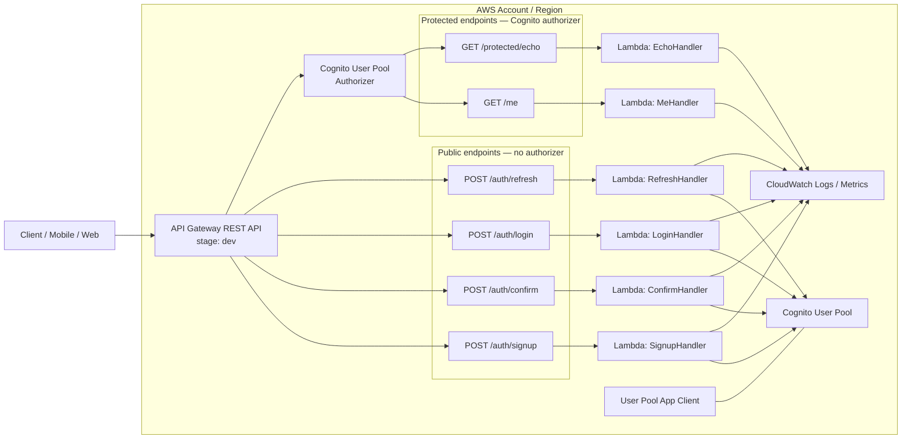
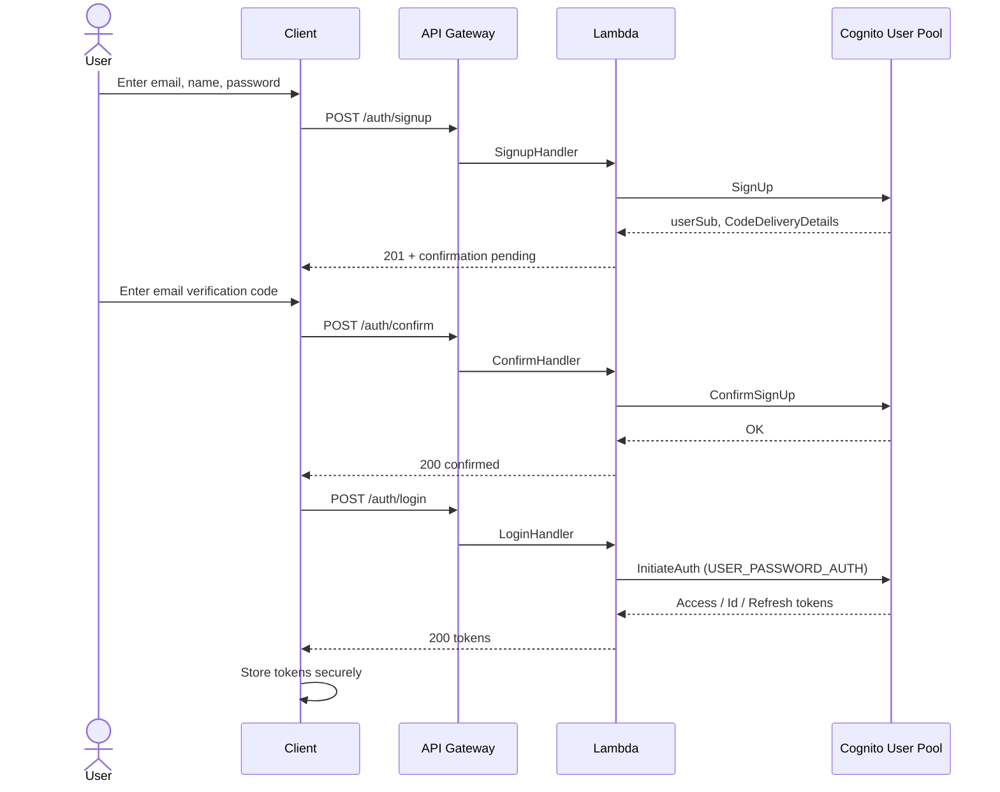
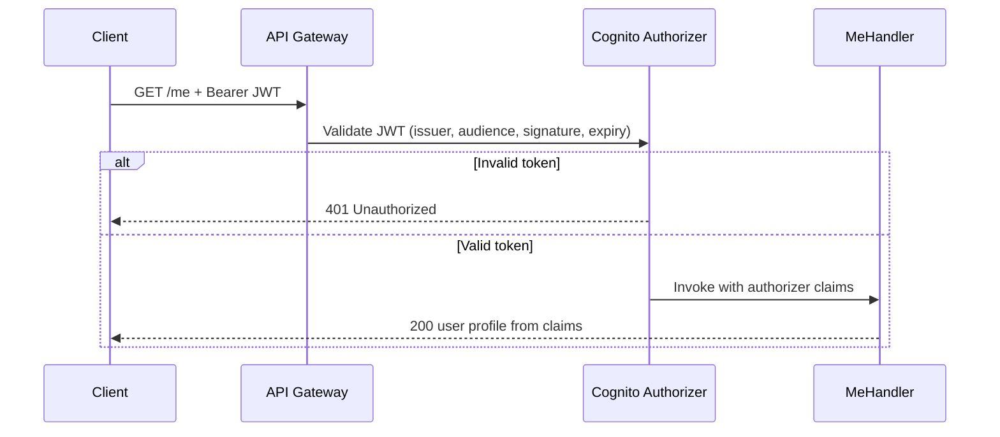
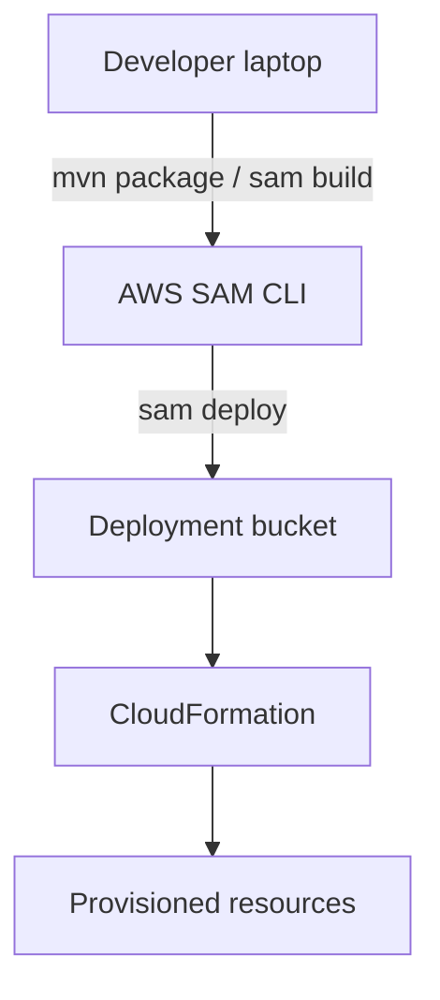

# System Design: AWS API Gateway + Lambda + Cognito (Java)

## 1. Goal

Build a serverless Java backend that:

- Registers, confirms, and authenticates users with **Amazon Cognito**
- Exposes HTTP APIs through **Amazon API Gateway**
- Runs business logic in **AWS Lambda** (Java)
- Protects private APIs with Cognito JWT authorization

This design is the blueprint for implementation. Decisions below fill gaps left by the empty repository (no code or written requirements today).

---

## 2. High-level architecture



### Design principles

| Principle | Choice |
|-----------|--------|
| Auth source of truth | Cognito User Pool (email as username) |
| Public vs private APIs | Auth routes public; business routes require Cognito JWT |
| Integration style | Lambda proxy integration |
| Infra as code | AWS SAM (`template.yaml`) |
| Language / runtime | Java 21, Maven, `aws-lambda-java-core` + AWS SDK v2 |
| Secrets | App client secret in Lambda env from CloudFormation; rotate later via Secrets Manager if needed |
| Observability | Structured JSON logs to CloudWatch; one log group per function |

---

## 3. Components

### 3.1 Amazon Cognito User Pool

| Setting | Value |
|---------|--------|
| Username | Email |
| Required attributes | `email`, `name` |
| Auto-verify | Email |
| MFA | Off (v1); optional later |
| Password policy | Min 8, upper, lower, number, symbol |
| Account recovery | Verified email |
| App client | Confidential client (`GenerateSecret: true`) |
| Auth flows | `USER_PASSWORD_AUTH`, `REFRESH_TOKEN_AUTH` |
| Token validity (v1) | Access/ID: 1 hour; Refresh: 30 days |

**Why Cognito owns auth:** avoids storing passwords, gets JWT verification for free via API Gateway authorizer, and keeps Lambda focused on orchestration and business logic.

### 3.2 API Gateway (REST)

- REST API (OpenAPI 3) with stage `dev`
- Cognito User Pool **authorizer** as default for protected resources
- Auth routes explicitly set `Auth: NONE`
- CORS enabled for configured origins (parameterized)
- Throttling: stage-level burst/rate limits (defaults first; tune later)

### 3.3 Lambda functions (Java 21)

| Function | Path | Auth | Responsibility |
|----------|------|------|----------------|
| `SignupHandler` | `POST /auth/signup` | None | `AdminCreateUser` or `SignUp` + optional `AdminAddUserToGroup` |
| `ConfirmHandler` | `POST /auth/confirm` | None | `ConfirmSignUp` with email + code |
| `LoginHandler` | `POST /auth/login` | None | `InitiateAuth` (USER_PASSWORD_AUTH); return tokens |
| `RefreshHandler` | `POST /auth/refresh` | None | Refresh tokens via `REFRESH_TOKEN_AUTH` |
| `MeHandler` | `GET /me` | Cognito | Return claims from authorizer context (`sub`, `email`, `name`) |
| `EchoHandler` | `GET /protected/echo` | Cognito | Sample protected business endpoint |

Shared library module (`common`) holds:

- Request/response DTOs and JSON mapping (Jackson)
- Cognito client wrapper (SDK v2)
- Error → HTTP status mapping
- Correlation ID / structured logging helpers

**Packaging:** thin JAR or shaded JAR per function (Maven assembly / Shade). Prefer one Maven multi-module project:

```
/
├── template.yaml
├── pom.xml                 # parent
├── common/                 # shared DTOs, Cognito client, errors
├── signup/
├── confirm/
├── login/
├── refresh/
├── me/
└── echo/
```

### 3.4 IAM

Each Lambda gets least-privilege:

| Function | Cognito / IAM actions |
|----------|------------------------|
| Signup | `cognito-idp:SignUp` (or `AdminCreateUser` if admin path) |
| Confirm | `cognito-idp:ConfirmSignUp` |
| Login / Refresh | `cognito-idp:InitiateAuth` |
| Me / Echo | None to Cognito (identity from authorizer claims) |

API Gateway → Lambda invoke permissions via SAM event mappings.

---

## 4. API contract

Base URL: `https://{api-id}.execute-api.{region}.amazonaws.com/dev`

### 4.1 `POST /auth/signup`

**Request**

```json
{
  "email": "user@example.com",
  "password": "Str0ng!Pass",
  "name": "Ada Lovelace"
}
```

**Responses**

| Status | Body |
|--------|------|
| `201` | `{ "userSub": "...", "userConfirmed": false, "message": "Confirmation code sent" }` |
| `400` | Validation / weak password / invalid email |
| `409` | User already exists |
| `500` | Unexpected |

### 4.2 `POST /auth/confirm`

```json
{ "email": "user@example.com", "code": "123456" }
```

| Status | Meaning |
|--------|---------|
| `200` | Confirmed |
| `400` | Invalid / expired code |
| `404` | User not found |

### 4.3 `POST /auth/login`

```json
{ "email": "user@example.com", "password": "Str0ng!Pass" }
```

**200**

```json
{
  "accessToken": "...",
  "idToken": "...",
  "refreshToken": "...",
  "expiresIn": 3600,
  "tokenType": "Bearer"
}
```

| Status | Meaning |
|--------|---------|
| `401` | Bad credentials / unconfirmed user |
| `400` | Validation |

### 4.4 `POST /auth/refresh`

```json
{ "refreshToken": "..." }
```

Returns new access/ID tokens (and refresh if rotated).

### 4.5 `GET /me` (protected)

Header: `Authorization: Bearer <idToken or accessToken>`

**200**

```json
{
  "sub": "uuid",
  "email": "user@example.com",
  "name": "Ada Lovelace"
}
```

### 4.6 `GET /protected/echo` (protected)

Returns `{ "message": "ok", "requestId": "..." }` to prove authorizer path.

---

## 5. Auth sequence flows

### 5.1 Sign-up → confirm → login



### 5.2 Calling a protected API



**Token choice for API Gateway Cognito authorizer:** use **ID token** or configure authorizer for access tokens with matching audience. Document client requirement: send the token type the authorizer expects (default recommendation: **ID token** for user-identity APIs).

---

## 6. Error model

Uniform JSON error body:

```json
{
  "error": "USER_NOT_CONFIRMED",
  "message": "User must confirm email before login",
  "requestId": "abc-123"
}
```

| Cognito / domain condition | HTTP | `error` code |
|----------------------------|------|--------------|
| Validation failure | 400 | `VALIDATION_ERROR` |
| UsernameExistsException | 409 | `USER_EXISTS` |
| CodeMismatch / ExpiredCode | 400 | `INVALID_CODE` |
| NotAuthorizedException | 401 | `UNAUTHORIZED` |
| UserNotConfirmedException | 401 | `USER_NOT_CONFIRMED` |
| UserNotFoundException | 404 | `USER_NOT_FOUND` |
| Throttling / LimitExceeded | 429 | `RATE_LIMITED` |
| Other | 500 | `INTERNAL_ERROR` |

Never echo Cognito internal details or stack traces to clients.

---

## 7. Security design

| Concern | Approach |
|---------|----------|
| Transport | HTTPS only (API Gateway) |
| Auth for business APIs | Cognito JWT authorizer (no custom authorizer in v1) |
| Credentials | Passwords only over TLS; never logged |
| Client secret | Env var from SAM; not returned to clients |
| Input validation | Bean Validation (or manual) on all public bodies |
| PII in logs | Log `sub` / requestId; redact email/password |
| CORS | Explicit allow-list via SAM parameter |
| IAM | Per-function policies; no `*` on Cognito where avoidable |
| Abuse | API Gateway throttling; Cognito built-in rate limits |
| Future hardening | WAF, MFA, Secrets Manager, advanced security mode |

---

## 8. Configuration & environments

SAM parameters:

| Parameter | Purpose |
|-----------|---------|
| `Environment` | `dev` / `stage` / `prod` |
| `CorsOrigin` | Allowed origin |
| `JavaRuntime` | `java21` |

Environment variables injected into auth Lambdas:

- `COGNITO_USER_POOL_ID`
- `COGNITO_CLIENT_ID`
- `COGNITO_CLIENT_SECRET`
- `AWS_REGION` (runtime-provided)

Stack naming: `apigw-lambda-cognito-java-{Environment}`.

---

## 9. Deployment topology



**CI/CD (recommended next):** GitHub Actions — build → unit tests → `sam deploy` to `dev` on merge to `main`; gated promote to `prod`.

**Local:** `sam local start-api` with env file; Cognito still needs a real (or mocked) pool for auth Lambdas. Unit-test Cognito wrapper with Mockito.

---

## 10. Observability

- Structured logs: `{ "level", "requestId", "handler", "message", "errorCode?" }`
- Metrics: Lambda duration/errors/throttles (default); custom metric `AuthLoginFailure` later
- Alarms (prod): 5xx rate, Lambda errors, Cognito throttling
- X-Ray: optional; enable when debugging latency

---

## 11. Testing strategy

| Layer | Scope |
|-------|--------|
| Unit | Handlers + mappers + Cognito client adapter (mocked SDK) |
| Contract | JSON schema / sample payloads for each route |
| Integration | Deployed `dev` stack: signup → confirm → login → GET /me |
| Negative | Bad password, unconfirmed login, expired JWT, missing Authorization |

---

## 12. Out of scope for v1

- Social IdPs (Google / Apple)
- MFA / WebAuthn
- Custom domains / ACM
- DynamoDB or other business data stores
- Admin user management APIs
- Multi-tenant pools
- GraphQL / HTTP API (v2) — REST only for now

These can extend the same Cognito pool and authorizer without redesigning the core auth spine.

---

## 13. Implementation roadmap

1. **Scaffold** — Maven multi-module + SAM `template.yaml` (User Pool, Client, API, Lambdas)
2. **Auth handlers** — signup, confirm, login, refresh + shared error model
3. **Protected handlers** — `/me`, `/protected/echo` + Cognito authorizer wiring
4. **Docs** — OpenAPI export from SAM / README deploy steps
5. **Tests** — unit + one smoke integration script
6. **Hardening** — CORS params, throttling, alarms, CI

---

## 14. Decision log

| Decision | Choice | Rationale |
|----------|--------|-----------|
| REST vs HTTP API | REST | Mature Cognito authorizer support; matches common Java samples |
| SignUp vs AdminCreateUser | Client `SignUp` | Self-service; email verification built-in |
| Shared vs monolith Lambda | Separate functions | Clear IAM, independent scaling, simpler permissions |
| ID vs Access token for `/me` | ID token | Carries profile claims without extra Cognito calls |
| IaC | SAM | Fastest path for API + Lambda + Cognito on AWS |

---

## 15. Open points (confirm before build)

1. **Region / AWS account** for first deploy  
2. **CORS origins** (web app URL(s))  
3. **Confirm whether refresh endpoint is required in v1** (recommended: yes)  
4. **Admin vs self-service signup** (design assumes self-service)  
5. **Whether client secret is acceptable** (mobile public clients may need secret-less + PKCE later)
